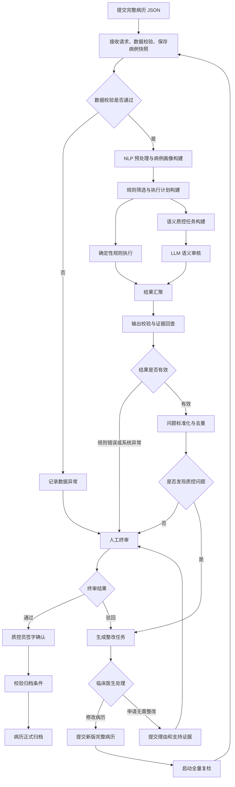
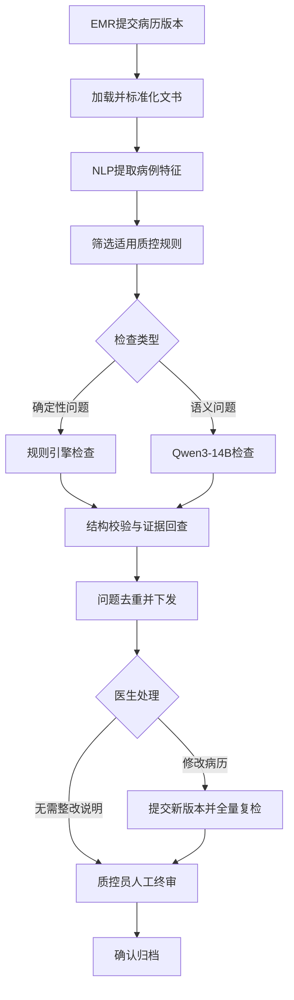
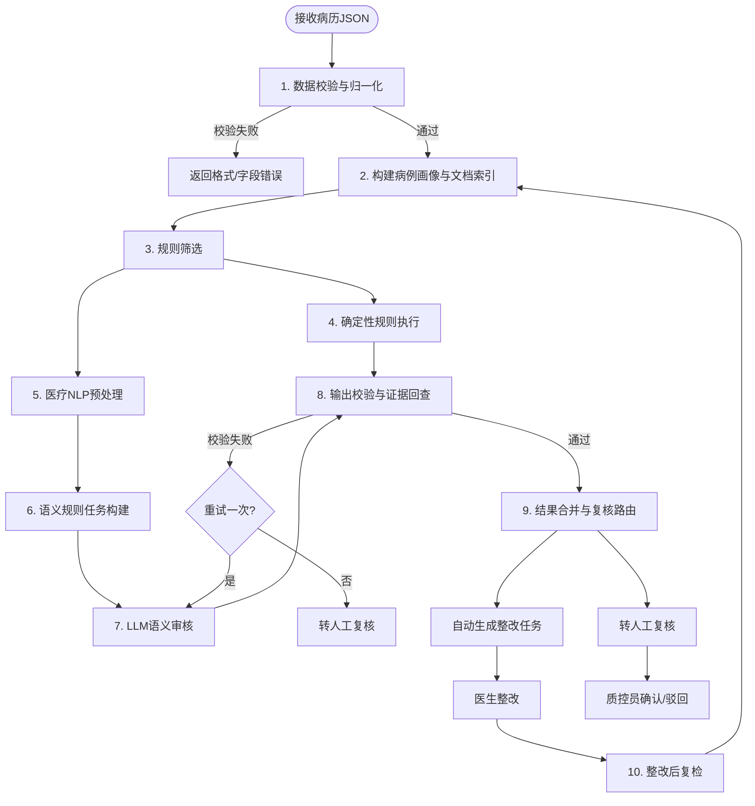
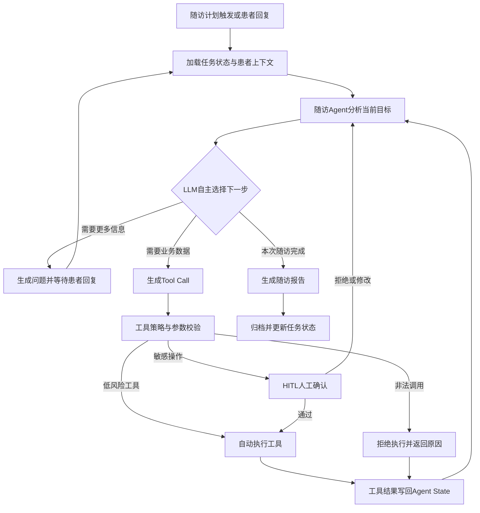
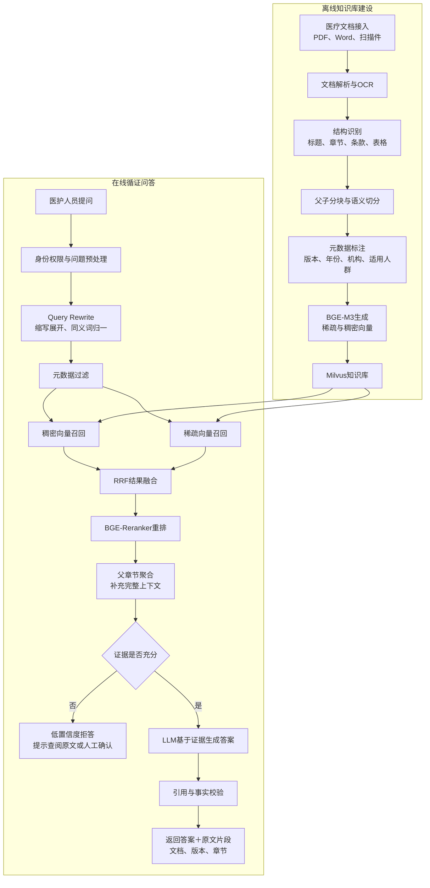
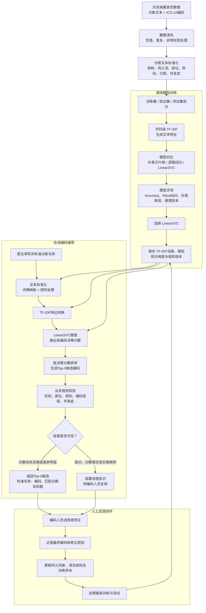

# 项目一
## 流程图


## 病历画像
把完整病历 JSON 抽象成少量关键特征，让规则筛选节点能够快速判断哪些规则适用、哪些规则不适用。
1. 患者基本信息 年龄、性别、是否儿童、是否老年人、是否孕妇、住院天数
2. 住院过程特征 是否做过手术、是否有手术记录、是否输过血、是否进行过抢救、是否死亡、是否住过重症监护室（ICU）、否转过科、住院总天数
3. 文书类型清单 入院记录、首次病程记录、日常病程记录、手术记录、术后首次病程记录、出院记录、病案首页、知情同意书、抢救记录、死亡记录
4. 诊断和手术特征 主要诊断编码和名称、主要诊断所属的大类（比如是脑血管病、心血管病、呼吸系统疾病等）、诊断数量、是否有重大手术、手术编码列表
5. 异常检验检查特征
6. 医疗安全相关特征 有没有院内感染、有没有并发症
```json
{
  "case_id": "CASE-20260815-001",
  "profile": {
    "age": 68,
    "sex": "M",
    "is_elderly": true,
    "is_pediatric": false,
    "has_surgery": true,
    "has_operation_record": true,
    "has_transfusion": false,
    "has_death_record": false,
    "has_rescue_record": false,
    "has_icu_record": false,
    "has_abnormal_lab": true,
    "has_critical_value": true,
    "has_abnormal_imaging": false,
    "has_complication": true,
    "has_unplanned_reoperation": false,
    "doc_types": [
      "入院记录",
      "首次病程记录",
      "日常病程记录",
      "手术记录",
      "术后首次病程记录",
      "出院记录",
      "病案首页"
    ],
    "main_diagnosis_code": "I63.900",
    "main_diagnosis_category": "脑血管病",
    "surgery_codes": ["00.6100"],
    "abnormal_lab_items": ["血钾", "血肌酐"],
    "length_of_stay_days": 12
  }
}
```
## 文档索引
文档索引就是把病历 JSON 中所有文书和关键字段的位置、类型、时间等信息提前整理好，后续规则执行和模型调用时可以直接按索引取数，不用每次都扫描整个 JSON，也方便证据回查时定位原文。
```json
{
  "doc_list": [
    {
      "doc_id": "DOC-001",
      "doc_type": "入院记录",
      "title": "入院记录",
      "field_path": "documents[0].content",
      "has_content": true
    },
    {
      "doc_id": "DOC-002",
      "doc_type": "首次病程记录",
      "title": "首次病程记录",
      "field_path": "documents[1].content",
      "has_content": true
    },
    {
      "doc_id": "DOC-003",
      "doc_type": "出院记录",
      "title": "出院记录",
      "field_path": "documents[2].content",
      "has_content": true
    }
  ],
  "field_map": {
    "homepage.main_diagnosis.code": "homepage.main_diagnosis.code",
    "discharge_summary.diagnosis.main.code": "documents[2].content"
  }
}
```
## 规则筛选
根据病例画像，从几百条质控规则中快速找出当前这份病历真正需要执行的规则，避免无关规则空跑，也避免把无关内容塞给后面的规则引擎或大模型。

读取规则的 trigger_conditions。
检查其中的每一个条件是否满足病例画像中的对应字段。
如果所有条件都满足，则这条规则被选中。
如果有一个条件不满足，则这条规则被跳过，并记录跳过原因。
例如：
有手术必须有手术记录 {"has_surgery": true}
病案首页主要诊断编码与出院记录主要诊断编码一致 {"has_homepage": true, "has_discharge_summary": true}

最终输出：
```json
{
  "匹配到的规则": [
    "D_COMP_001",
    "D_TIME_001",
    "D_CONSIST_001",
    "S_LAB_ANALYSIS_001"
  ],
  "跳过的规则": [
    {
      "规则ID": "D_DEATH_001",
      "跳过原因": "病例无死亡记录"
    },
    {
      "规则ID": "D_TRANSFUSION_001",
      "跳过原因": "病例无输血记录"
    }
  ]
}
```

# 第一项目：住院病历内涵质控与闭环整改平台

先明确定位：这个项目不是让LLM自由决策的Agent，而是一个由LangGraph编排的、有状态的质控工作流。LLM只负责复杂语义判断，流程控制、规则筛选、结果校验和人工审核都是确定性的。

以下案例是符合真实业务的脱敏模拟案例，用于面试讲解。

## 一、完整业务流程



### 1. 创建质控任务

医生提交病历或质控员发起终末质控后，EMR通过FastAPI接口传入：

* 就诊ID、患者ID；
* 病历版本号；
* 科室、主要诊断；
* 文书ID和文书类型；
* 本次触发方式。

系统生成`task_id`和LangGraph的`thread_id`，防止同一病历重复创建任务。

### 2. 加载并标准化病历

系统根据就诊ID加载入院记录、病程记录、手术记录、检验报告、病理报告、出院记录等文书。

这一阶段主要完成：

* 统一文书类型和字段名称；
* 去除HTML标签和无意义模板内容；
* 保留文书ID、版本、作者和书写时间；
* 将长文书按照段落和字段切分。

### 3. NLP提取病例特征

已有医疗NLP服务提取：

* 诊断、症状、手术、药物、检验等实体；
* 数值、单位和发生时间；
* 文书所属阶段；
* 病例的主要诊断、手术及异常检验标签。

这些结果主要用于筛选规则和定位文书，不直接作为最终质控结论。

### 4. 筛选适用规则

系统不会把整个规则库交给LLM，而是根据病例特征筛选。

例如：

> 胃肠外科＋存在病理报告＋病理结果在出院前生成＋出院记录已完成

才会加载“病理结果与出院诊断一致性”规则。

完整性、时效性等确定性规则由规则引擎执行；诊断变化、跨文书矛盾等复杂问题才进入LLM节点。

### 5. LLM语义检查

传给Qwen3-14B的内容包括：

* 当前质控规则；
* NLP提取结果；
* 与规则相关的少量文书片段；
* 文书ID、时间和版本；
* 固定的输出结构。

LLM输出类似：

| 字段               | 内容                   |
| ---------------- | -------------------- |
| rule_id          | DIAG_CONSISTENCY_012 |
| issue_type       | 诊断不一致                |
| document_id      | discharge_003        |
| evidence         | 出院诊断：胃间质瘤            |
| related_evidence | 病理诊断：胃腺癌             |
| reason           | 病理结果已在出院前明确，但出院诊断未同步 |
| severity         | 中风险                  |
| confidence       | 0.93                 |

### 6. 结果校验与去重

Pydantic只能保证字段类型正确，不能证明内容正确，因此还要继续检查：

* 文书ID是否存在；
* 引用原文能否在对应文书中找到；
* 文书版本是否仍然有效；
* 两份证据的时间关系是否成立；
* 问题类型是否在允许范围内。

校验通过后，根据“就诊ID＋规则ID＋目标文书＋问题对象”生成问题指纹，合并不同规则发现的重复问题。

### 7. 医生整改与人工终审

医生可以：

* 修改病历；
* 提交无需整改说明；
* 对问题提出异议。

医生提交修改后生成新病历版本，系统重新执行全量检查。试点阶段选择全量复检，是为了避免修改一份文书后影响其他跨文书规则。

最终由质控员统一审核，确认问题是否有效及整改是否完成。

## 二、LangGraph保存什么

LangGraph State主要保存：

* `task_id`、`thread_id`；
* 当前病历版本；
* 已完成节点；
* 适用规则列表；
* 候选问题；
* 校验后问题；
* 重试次数；
* 医生和质控员操作结果。

PostgreSQL Checkpointer保存的是工作流运行状态和恢复点。

正式业务数据单独保存：

* 质控任务表；
* 质控问题表；
* 整改记录表；
* 病历版本索引表；
* 操作审计表。

这两部分不能混为一谈。

## 三、Good Case：正确识别诊断变化

### 病历情况

患者入院时初步诊断为“胃间质瘤”，住院期间完成病理检查。

* 入院记录：考虑胃间质瘤；
* 病理报告：胃腺癌；
* 病程记录：已记录病理诊断结果；
* 出院记录：出院诊断仍为胃间质瘤；
* 病理报告在出院前已经生成。

### 系统处理

1. NLP提取“胃间质瘤”“胃腺癌”和对应时间。
2. 系统命中“诊断发生变化＋存在病理结果”标签。
3. 筛选出诊断一致性规则。
4. LLM比较病理报告、病程记录和出院记录。
5. Pydantic校验输出结构。
6. 系统回查引用原文和报告时间。
7. 生成“病理结果与出院诊断不一致”问题。
8. 医生确认后修改出院诊断。
9. 系统对新版本全量复检，原问题自动关闭。
10. 质控员确认后归档。

这个案例的价值不是LLM发现了两个不同词，而是系统结合了**文书类型、时间顺序、诊断变化和最终病历版本**。

## 四、Bad Case 1：病理报告晚于出院时间

### 错误表现

患者出院时病理结果尚未生成，出院诊断仍然是“胃部占位待查”。两天后病理报告返回，系统如果只比较文本，就可能错误提示：

> 出院诊断与病理结果不一致。

### 问题原因

最初只做了实体和文本比较，没有验证病理报告是否在出院前可用。

### 处理方式

增加时间约束：

> 只有病理报告签发时间早于出院记录完成时间，才检查出院诊断是否同步。

如果病理结果晚于出院时间，则不判定为原病历缺陷，可进入后续诊断补充流程。

### 面试亮点

这说明医疗文本不能只比较语义，还必须处理**时间关系和医生当时能够获得的信息范围**。

## 五、Bad Case 2：否定表达导致规则误选

### 错误表现

入院记录中写着：

> 患者否认糖尿病病史。

NLP服务提取出“糖尿病”实体，系统误将患者识别为糖尿病患者，加载糖尿病相关质控规则。

### 问题原因

实体抽取只识别了疾病名称，没有正确处理否定语境。

### 处理方式

* 保留实体所在原文和上下文；
* 增加“否认、未见、排除、考虑”等语境标签；
* 规则筛选时只使用肯定且当前有效的诊断；
* 低置信度实体不直接触发专病规则。

这类问题不能简单地依赖LLM二次判断，应该尽量在规则筛选阶段排除。

## 六、Bad Case 3：LLM生成了不存在的引用

### 错误表现

LLM输出格式完全正确，但生成的“引用原文”并不存在于指定文书中。

Pydantic能够通过，因为字段和类型都正确，但证据是错误的。

### 处理方式

系统根据`document_id`回查原始文书：

* 引用能够精确或标准化匹配：保留；
* 引用不存在：携带原文重新生成一次；
* 重试后仍不存在：丢弃该问题或进入人工复核；
* 不允许无原文依据的问题直接下发给医生。

这也是为什么简历中要强调“Pydantic校验＋引用原文回查”，两者解决的不是同一个问题。

## 七、项目最主要的三个难点

### 1. 不能把整份病历和全部规则交给LLM

病历过长、规则过多，会带来上下文超长、推理速度慢和规则互相干扰。

解决方法是：

> NLP提取病例特征 → 筛选规则 → 定位相关文书 → LLM只检查一个具体问题。

### 2. 医疗问题高度依赖时间和上下文

同一个诊断在入院、术前、术后和出院阶段发生变化，不一定是矛盾。必须结合文书时间、病理结果时间和诊断演变过程判断。

### 3. 病历在检查过程中可能被修改

如果系统检查的是版本V1，医生已经提交V2，就不能继续把V1的问题下发。

解决方式是在任务开始和问题写入前检查病历版本。版本不一致时废弃旧结果，并基于最新版本重新执行。

## 八、面试时可以直接这样介绍

> 这个项目不是把整份病历和所有规则直接交给大模型，而是先通过医疗NLP服务提取诊断、手术、检验和时间等病例特征，再根据科室、文书类型和病例特征筛选适用规则。完整性和时效性问题由确定性规则检查，诊断变化和跨文书一致性等复杂问题才交给私有化部署的Qwen3-14B。大模型输出后，我们还会通过Pydantic校验结构、回查文书ID和引用原文，并结合时间关系过滤无效结果。校验通过的问题生成指纹去重后下发给医生，医生修改病历后重新执行全量检查，最后由质控员审核归档。LangGraph主要解决多节点编排、人工审核暂停恢复和病历整改后的循环复检问题。

## 总结
### 1. 最终推荐方案及推荐理由

最终推荐方案：

> **规则引擎 + 医疗NLP/大模型双引擎 + LangGraph 工作流编排 + 证据回查与复核状态机**

核心原则不变：  
**确定性规则优先，医疗NLP做抽取和初筛，大模型只处理规则覆盖不了、且经过规则筛选后的语义任务；所有结论必须绑定原文证据；高风险、不确定结果转人工复核。**  
但在流程编排上，使用 **LangGraph** 作为正式的工作流执行引擎，而不是普通的任务队列或手写状态机。

#### 为什么这里使用 LangGraph 是必要的

虽然抽象上“普通状态机”可以表达同样的流程，但在真实二级医院落地时，LangGraph 提供了以下无法由简单队列或手写状态机低成本、可靠替代的能力：

1. **持久化图状态与检查点（Checkpointing）**  
   质控流程涉及多节点、多分支、重试、人工复核、整改复检等长流程。LangGraph 原生支持对图状态的持久化和恢复，可以在任意节点失败后从断点续跑，而不是整个病例从头开始。这在医院业务中意味着不会因为一次临时故障导致整份病历重跑，也不会丢失中间结果。

2. **显式条件分支与循环**  
   质控流程存在大量条件分支：
   - 数据校验失败 → 直接返回；
   - 规则筛选后，确定性规则和语义规则并行/串行执行；
   - 语义任务输出校验失败 → 重试一次 → 仍失败转人工；
   - 医生整改后 → 局部复检或全量复检。
   LangGraph 的 `conditional_edges` 和 `cycle` 机制让这些分支和循环天然可建模、可调试，而手写状态机通常需要大量的 if-else 和状态变量管理，容易出错且难以维护。

3. **原生支持人工介入节点（Human-in-the-loop）**  
   本系统有大量人工复核环节。LangGraph 提供 `interrupt` 和 `send` 机制，可以让流程在需要人工决策时暂停，等待质控员输入后继续执行。这样可以保证“自动下发”与“人工复核”边界在流程引擎层强制执行，而不是依赖应用代码中的“状态标记”。

4. **可观测性与调试**  
   医疗质控需要可审计、可追溯。LangGraph 将整个执行过程表示为图，节点、边、状态变化都可以被记录和可视化。出现问题时，可以通过轨迹追踪到具体节点和状态，比阅读散乱的队列日志高效得多。

5. **避免重复造轮子**  
   自研一套健壮、支持持久化、条件分支、循环、人工介入、失败重试的流程引擎，工作量可能远超直接使用 LangGraph。尤其在二级医院 IT 资源有限的情况下，采用成熟的开源框架是更合理的选择。

因此，虽然理论上普通状态机可以实现相同功能，但在工程可靠性、可维护性、可观测性和开发效率上，LangGraph 具有明确的必要性。它不是用来包装伪工具的 Agent 框架，而是作为纯流程编排引擎，服务于质控业务流程。

---

### 2. 完整系统架构图

```text
医院端
  │
  ▼
FastAPI 对外接口
  │
  ├──> 提交服务 / 复检服务
  │
  ▼
LangGraph 工作流引擎（持久化状态、条件分支、人工介入、检查点）
  │
  ├──> 1. 数据校验与归一化
  ├──> 2. 病例画像构建
  ├──> 3. 规则筛选
  │      │
  │      ├──> 确定性规则引擎
  │      │
  │      └──> 医疗NLP预处理
  │             │
  │             └──> 语义规则任务构建
  │                    │
  │                    └──> LLM 语义审核
  │
  ├──> 输出校验与证据回查
  ├──> 复核路由
  │      ├──> 自动生成整改任务
  │      └──> 转人工复核（人工介入节点）
  │
  ▼
PostgreSQL 保存规则、病例、结果、证据、任务、复核记录
```

说明：  
LangGraph 负责流程编排，不承担 Agent 决策职责。所有确定性判断、NLP 抽取、LLM 语义判断仍是独立的服务模块，由 LangGraph 节点调用。

---

### 3. LangGraph 工作流节点图



条件分支：  
- 数据校验失败 → 直接结束，不进入质控。
- 输出校验失败 → 判断是否已重试，若未重试则返回语义审核节点；若已重试仍失败，则转人工。
- 复核路由根据结果类型、风险等级、证据状态决定自动下发或人工复核。

---

### 4. 每个节点的输入、处理和输出

| 节点 | 输入 | 处理 | 输出 |
|---|---|---|---|
| 1. 数据校验与归一化 | 完整 JSON | 校验接口字段、必填项、日期格式、枚举、编码结构 | 校验通过/失败信息 |
| 2. 构建病例画像与文档索引 | 校验通过后的 JSON | 抽取有无手术、死亡、输血、异常检验、文书类型、核心诊断等特征 | case_profile、doc_index |
| 3. 规则筛选 | case_profile、规则元数据 | 匹配规则 trigger_conditions | matched_rules |
| 4. 确定性规则执行 | 结构化字段、确定性规则 | 执行字段比较、时间逻辑、完整性检查 | 确定性质控结果 |
| 5. 医疗NLP预处理 | 文书全文、检验检查结果 | 识别异常指标、药品名、手术名、文书时间、关键句子 | NLP 结构化结果 |
| 6. 语义规则任务构建 | matched_rules 中的语义规则、NLP结果、文档片段 | 构造最小化 LLM 输入，避免全量 JSON 注入 | semantic_tasks |
| 7. LLM 语义审核 | semantic_tasks | 逐条或批量调用 LLM，输出结构化判断 | 语义质控结果 |
| 8. 输出校验与证据回查 | 所有质控结果 | JSON Schema 校验、业务字段校验、证据原文回查 | 可下发结果、需重试结果、需转人工结果 |
| 9. 结果合并与复核路由 | 通过校验的结果 | 按规则风险、结果类型、置信度路由 | 自动整改任务或人工复核任务 |
| 10. 整改后复检 | 医生重新提交的 JSON、历史版本 | diff 计算、规则依赖匹配、全量/局部复检 | 新结果、整改状态、新问题列表 |

---

### 5. 关键架构问题逐条回答

#### Q1：完整病历 JSON 进入系统后，每一步做什么？

由 LangGraph 图中的节点依次执行：  
**接收 → 数据校验 → 病例画像 → 规则筛选 → 确定性规则/NLP/LLM → 证据回查 → 复核路由 → 整改任务/人工复核 → 整改复检。**

每个节点负责一个明确任务，LangGraph 根据条件决定下一步。

### Q2：数据校验失败与发现病历质控问题有什么区别？

数据校验失败是接口契约问题，例如：

- 缺少 patient_id、visit_id；
- 日期格式错误；
- 诊断编码不是字符串；
- 文书内容为 null。

这类问题说明提交数据本身不可用，系统直接拒绝或返回校验错误，不进入质控业务判断。

病历质控问题是业务缺陷，例如：

- 缺少首次病程记录；
- 病案首页主要诊断与出院记录不一致；
- 异常血钾没有分析记录。

这类问题生成质控结果，并绑定证据。

#### Q3：哪些问题必须由确定性规则判断？

主要包括：

- 文书是否存在；
- 必填字段是否为空；
- 书写时间是否在要求时限内；
- 病案首页诊断编码、手术编码是否合法；
- 出院记录与病案首页的性别、年龄、住院号是否绝对一致；
- 主要诊断编码是否完全相等；
- 手术记录数量与手术编码数量是否一致；
- 知情同意书是否存在；
- 死亡记录、抢救记录是否因死亡/抢救触发；
- 检验结果是否超出参考范围。

#### Q4：哪些问题需要医疗NLP或大模型？

医疗NLP适合：

- 识别异常检验指标及其数值；
- 识别文书中的时间表达；
- 识别药品名称、手术名称、诊断描述；
- 检索病程记录中是否提到某异常指标或处理措施。

大模型适合：

- 跨文书语义一致性，如出院记录“脑梗死”与病案首页“I63.900”是否一致；
- 诊断依据是否充分；
- 异常检查是否被真正分析，而不是仅罗列；
- 病情变化是否被记录和解释；
- 手术记录与术后病程的语义一致性。

#### Q5：是否需要对语义任务进行简单、复杂分级？

需要。

否则会出现两种问题：

1. 可用 NLP 或确定性逻辑解决的简单问题也调用大模型，增加成本和不确定性；
2. 真正需要推理的任务与简单任务混在一起，导致提示词复杂、输出不稳定。

#### Q6：如果需要分级，由谁判断，依据是什么？

由规则配置中的 `task_level` 字段决定，在规则筛选后生成任务时判断。

依据：

- 是否可由确定性字段比较完成；
- 是否可由医疗NLP或关键词检索完成；
- 是否需要跨多份文书联合推理；
- 是否依赖医学知识判断“是否合理”“是否充分”；
- 规则风险等级和输出是否便于证据验证。

#### Q7：数据库中存在几百条质控规则时，如何选择当前病例适用的规则？

规则表包含 `trigger_conditions`。

例如：

```json
{
  "has_surgery": true,
  "has_operation_record": true
}
```

系统先构建病例画像，然后逐条匹配触发条件。  
只有命中的规则才进入执行队列。这样避免把几百条规则全部运行，更不会全部传给大模型。

#### Q8：SQL是固定模板、SQLAlchemy动态拼接，还是由大模型生成？

**禁止大模型生成 SQL。**

推荐：

- 确定性字段读取直接用 Python/Pydantic 对象；
- 需要查询历史或字典时，使用固定 SQL 模板或 SQLAlchemy Query Builder；
- 所有查询参数化。

理由：安全、可审计、可复现。

#### Q9：规则正文应该全部传给大模型，还是只传筛选后的规则？

**只传筛选后的语义规则。**

同时传：

- 规则 ID；
- 检查目标；
- 判断标准；
- 输出格式；
- 涉及文书片段。

确定性规则不传给大模型。  
一次任务最多传少量语义规则，避免上下文混乱。

#### Q10：病历已经作为完整 JSON 传入后，哪些内容应直接作为模型输入？

对大模型来说，不应直接传完整 JSON。应构造最小化质控包：

- 患者基本信息摘要；
- 本次质控规则；
- 与该规则相关的文书片段；
- 医疗NLP预处理结果，如异常检验列表；
- 需要比较的字段原文。

结构化字段判断由规则引擎完成，不依赖大模型。

#### Q11：哪些能力才有必要设计成 Agent 工具？

在本系统里：**没有**。

只有当系统需要：

- 查询外部知识库；
- 调用医院 EMR/HIS/LIS/PACS；
- 根据第一步结果动态决定下一步检索方向；
- 多轮搜索标准条文或历史病例；

才需要考虑工具。当前完整 JSON 已传入，不需要 Agent。

#### Q12：如何避免把“获取诊断、获取手术”等已有JSON数据包装成伪工具？

设计上明确：

- JSON 读取通过内部数据访问层完成，不作为工具开放；
- 工具清单只能包含外部系统、外部知识库或需要复杂计算的模块；
- 如果某个“工具”只是 `get_patient_info()` 或 `get_diagnosis()`，则判定为伪工具，禁止进入设计。

#### Q13：如何验证大模型引用的证据确实存在？

模型输出必须包含 `evidence` 数组，每一项包括：

- doc_id；
- field_path；
- quote；
- evidence_type。

校验器会：

1. 验证 doc_id 存在；
2. 验证 field_path 可解析；
3. 对 quote 做归一化，如去除空白、全半角差异、标点差异；
4. 检查 quote 是否包含在对应文书原文中。

任一失败，该问题不得自动下发给医生。

#### Q14：如何验证模型输出格式和业务字段有效？

使用 Pydantic 定义输出契约：

- result 必须是 `compliant / deficient / uncertain`；
- rule_id 必须属于本次任务规则；
- confidence 在 0-1；
- evidence 数组结构正确；
- doc_id 必须存在；
- field_path 必须可解析；
- suggested_action 必须是字符串。

解析失败或字段无效时，重试一次。仍失败转人工。

#### Q15：医学语义结论无法由代码完全验证时，如何控制风险？

控制原则：

1. 语义结论只作为“疑似问题”，不能直接作为医疗事实；
2. 必须绑定原文证据；
3. 高风险规则强制人工复核；
4. 输出携带规则版本、模型版本、提示词版本；
5. 对不确定结论一律转人工；
6. 自动下发的问题允许医生申诉；
7. 上线初期可让所有语义问题先进入人工复核，稳定后再逐步放宽。

#### Q16：哪些结果可以自动生成整改任务？

以下结果可自动生成整改任务：

- 确定性规则命中；
- 证据回查通过；
- 整改动作明确；
- 风险等级为低或中；
- 非死亡、非诊断依据不足、非重大手术并发症等敏感问题。

例如：

- 缺少某项文书；
- 病案首页性别与出院记录不一致；
- 住院号不一致；
- 手术记录缺失；
- 知情同意书缺失。

#### Q17：哪些结果必须转人工复核？

必须转人工的情况：

- 证据回查失败；
- 输出格式校验失败且重试后仍失败；
- 语义规则涉及诊断依据是否充分；
- 病情变化是否分析；
- 异常检查是否处理；
- 死亡病例相关问题；
- 手术安全相关重大问题；
- 模型输出 `uncertain`；
- 医生申诉；
- 多次整改仍未通过。

#### Q18：如何减少人工复核比例，同时避免错误问题大量下发给医生？

采用分级路由：

| 结果类型 | 处理方式 |
|---|---|
| 确定性规则命中，证据通过 | 自动生成整改任务 |
| 低风险语义规则命中，证据充分 | 稳定期可自动下发，初始期人工抽检 |
| 高风险语义规则命中 | 人工复核后再下发 |
| 证据不足或不确定 | 人工复核 |

同时通过以下方式降低误报：

- 规则筛选保证规则适用；
- 证据回查防止模型幻觉；
- 医生可申诉；
- 人工复核结果可反哺规则和提示词。

#### Q19：医生整改后如何判断只复检相关规则，还是重新检查整份病历？

系统比较两次提交的 JSON diff。

判断逻辑：

- 如果只变更了局部字段，且这些字段只影响部分规则，则只复检相关规则；
- 如果涉及核心字段，如病案首页主要诊断、手术编码、年龄、性别、住院号、新增或删除文书、死亡记录，则全量重跑；
- 系统提供 `force_full_check` 参数；
- 所有历史质控结果按版本保存，便于对比。

#### Q20：LangGraph 在系统中到底负责什么？普通任务队列或状态机能否替代？

在本系统中，**LangGraph 负责整个质控流程的编排与执行**，包括节点调度、条件分支、循环重试、人工介入暂停/恢复、检查点持久化。

普通任务队列或手写状态机在抽象上可以表达相同逻辑，但存在以下工程缺陷：

- 手写状态机需要额外实现持久化、恢复、分支合并、重试计数、人工介入中断等机制，复杂且易错；
- 任务队列缺乏内生的条件分支和循环控制，需要应用层维护大量状态变量；
- 可观测性和轨迹追踪需要自己埋点，成本高；
- 人工介入节点需要自己实现暂停/恢复机制，容易与队列消费者模型冲突。

LangGraph 提供了上述能力的标准实现，降低了开发和长期维护成本。对于需要高可靠性和可审计性的医疗质控系统，这不是“为了用而用”，而是工程合理性的选择。

---

### 6. 规则表核心字段设计

```sql
CREATE TABLE qc_rule (
  rule_id              VARCHAR PRIMARY KEY,
  rule_name            VARCHAR NOT NULL,
  category             VARCHAR NOT NULL, -- completeness/timeliness/consistency/diagnosis_basis/treatment_record/abnormal_analysis/homepage_consistency
  rule_type            VARCHAR NOT NULL, -- deterministic/nlp/llm
  trigger_conditions   JSONB NOT NULL,
  data_dependencies    JSONB NOT NULL,
  check_logic          JSONB,            -- deterministic logic
  nlp_task             JSONB,            -- nlp task config
  prompt_template      TEXT,             -- llm prompt
  output_schema        JSONB NOT NULL,
  risk_level           VARCHAR NOT NULL, -- low/medium/high
  review_policy        VARCHAR NOT NULL, -- auto/auto_with_sample/human_required
  auto_rectifiable     BOOLEAN NOT NULL,
  standard_basis       TEXT,
  version              INT NOT NULL,
  status               VARCHAR NOT NULL, -- active/inactive/draft
  created_at           TIMESTAMPTZ NOT NULL DEFAULT NOW(),
  updated_at           TIMESTAMPTZ NOT NULL DEFAULT NOW()
);
```

示例字段说明：

```json
{
  "rule_id": "S_LAB_ANALYSIS_001",
  "category": "abnormal_analysis",
  "rule_type": "llm",
  "trigger_conditions": {
    "has_abnormal_lab": true,
    "has_progress_note": true
  },
  "data_dependencies": {
    "abnormal_labs": "lab_report.items[*]",
    "progress_notes": "documents[?type=='病程记录'].content"
  },
  "risk_level": "high",
  "review_policy": "human_required",
  "auto_rectifiable": false
}
```

---

### 7. 规则筛选示例

输入病例画像：

```json
{
  "case_id": "CASE-20260815-001",
  "features": {
    "has_surgery": true,
    "has_operation_record": true,
    "has_transfusion": false,
    "has_death_record": false,
    "has_abnormal_lab": true,
    "has_progress_note": true,
    "doc_types": [
      "入院记录",
      "首次病程记录",
      "手术记录",
      "术后首次病程记录",
      "出院记录",
      "病案首页"
    ]
  }
}
```

规则筛选结果：

```json
{
  "matched_rules": [
    "D_COMP_001",
    "D_TIME_001",
    "D_CONSIST_001",
    "S_LAB_ANALYSIS_001",
    "S_OP_RECORD_001"
  ],
  "skipped_rules": 168,
  "skip_reasons": {
    "D_TRANSFUSION_001": "无输血记录",
    "D_DEATH_001": "无死亡记录",
    "D_ICU_001": "无ICU记录"
  }
}
```

---

### 8. 一条确定性规则的完整执行示例

规则：**病案首页主要诊断编码与出院记录主要诊断编码必须一致。**

```json
{
  "rule_id": "D_CONSIST_001",
  "rule_type": "deterministic",
  "trigger_conditions": {
    "has_homepage": true,
    "has_discharge_summary": true
  },
  "data_dependencies": {
    "left": "homepage.main_diagnosis.code",
    "right": "discharge_summary.diagnosis.main.code"
  },
  "check_logic": {
    "operator": "equals"
  }
}
```

执行结果：

```json
{
  "case_id": "CASE-20260815-001",
  "rule_id": "D_CONSIST_001",
  "result": "deficient",
  "risk_level": "high",
  "message": "病案首页主要诊断编码与出院记录主要诊断编码不一致",
  "evidence": [
    {
      "doc_type": "病案首页",
      "field_path": "main_diagnosis.code",
      "quote": "I63.900"
    },
    {
      "doc_type": "出院记录",
      "field_path": "diagnosis.main.code",
      "quote": "I63.901"
    }
  ],
  "suggested_action": "核对主要诊断编码，修改病案首页或出院记录，确保二者一致。",
  "route": "auto_rectifiable"
}
```

---

### 9. 一条跨文书语义规则的完整执行示例

规则：**异常检验结果是否在病程记录中分析处理。**

执行步骤：

1. 医疗NLP从检验报告中抽取异常项：血钾 6.2 mmol/L。
2. 确定性逻辑判断超出参考范围。
3. 医疗NLP检索病程记录中是否出现“血钾”“钾”“高钾”“补钾”“降钾”“葡萄糖酸钙”“利尿”等相关词。
4. 若未检索到相关分析和处理，将任务交给大模型做最终语义判断。

模型输出：

```json
{
  "rule_id": "S_LAB_ANALYSIS_001",
  "result": "deficient",
  "confidence": 0.93,
  "message": "检验报告提示血钾 6.2 mmol/L，高于参考范围上限，但现有病程记录中未见高钾血症原因分析、处理措施或复查计划。",
  "evidence": [
    {
      "doc_id": "DOC-LAB-001",
      "doc_type": "检验报告",
      "field_path": "items[0].value",
      "quote": "6.2",
      "evidence_type": "source"
    },
    {
      "doc_id": "DOC-PN-001",
      "doc_type": "病程记录",
      "field_path": "content",
      "quote": null,
      "evidence_type": "absence"
    }
  ],
  "suggested_action": "在病程记录中补充高钾血症原因分析、处理措施及复查计划。",
  "route": "human_review_required"
}
```

---

### 10. 模型结构化输入和输出JSON示例

#### 模型输入

```json
{
  "case_id": "CASE-20260815-001",
  "rule_id": "S_LAB_ANALYSIS_001",
  "rule_text": "判断检验报告中的异常结果是否在病程记录中有分析和处理记录。",
  "patient_summary": {
    "age": 68,
    "sex": "M",
    "main_diagnosis": "慢性肾脏病5期",
    "allergies": []
  },
  "documents": [
    {
      "doc_id": "DOC-PN-001",
      "doc_type": "病程记录",
      "title": "2026-08-14 日常病程记录",
      "content": "患者今日无特殊不适，继续原治疗方案。"
    },
    {
      "doc_id": "DOC-LAB-001",
      "doc_type": "检验报告",
      "title": "2026-08-14 血生化",
      "content": "血钾 6.2 mmol/L，参考范围3.5-5.3；血肌酐 420 μmol/L，参考范围57-97。"
    }
  ],
  "abnormal_labs": [
    {
      "item": "血钾",
      "value": "6.2",
      "unit": "mmol/L",
      "ref": "3.5-5.3",
      "source_doc_id": "DOC-LAB-001"
    }
  ],
  "output_schema": {
    "result": "compliant|deficient|uncertain",
    "confidence": "0-1",
    "evidence": "array of {doc_id, field_path, quote, evidence_type}",
    "suggested_action": "string"
  }
}
```

#### 模型输出

```json
{
  "rule_id": "S_LAB_ANALYSIS_001",
  "result": "deficient",
  "confidence": 0.93,
  "message": "异常检验血钾 6.2 mmol/L 在现有病程记录中未见原因分析和处理记录。",
  "evidence": [
    {
      "doc_id": "DOC-LAB-001",
      "field_path": "items[0].value",
      "quote": "6.2",
      "evidence_type": "source"
    },
    {
      "doc_id": "DOC-PN-001",
      "field_path": "content",
      "quote": null,
      "evidence_type": "absence"
    }
  ],
  "suggested_action": "补充高钾血症原因分析、处理措施及复查计划。"
}
```

---

### 11. 结果校验和证据回查方法

#### 输出校验

使用 Pydantic 校验：

- JSON 结构；
- 枚举字段；
- 规则 ID 是否属于当前任务；
- doc_id 是否存在；
- field_path 是否可解析；
- confidence 是否在 0-1；
- 是否包含必要的 message 和 suggested_action。

#### 证据回查

对 `evidence_type == "source"` 的证据：

1. 找到对应 doc_id；
2. 找到 field_path 对应内容；
3. 归一化 quote；
4. 做包含匹配或相似度计算。

对 `evidence_type == "absence"` 的证据：

1. 验证 doc_id 存在；
2. 验证 field_path 存在；
3. 不要求 quote 匹配，但要求 message 中明确说明“未见分析记录”。

#### 回查失败处理

- 第一次回查失败：重试一次；
- 第二次仍失败：该问题转人工复核；
- 不允许无证据或证据不存在的语义问题自动下发给医生。

---

### 12. 自动处理与人工复核的边界

| 场景 | 处理方式 |
|---|---|
| 确定性规则命中，证据校验通过 | 自动生成整改任务 |
| 确定性规则命中，涉及死亡或重大手术 | 自动生成任务，同时抽检或人工确认 |
| 低风险语义规则命中，证据充分，置信度高 | 稳定期可自动下发，初期人工抽检 |
| 高风险语义规则命中 | 人工复核后再下发 |
| 模型输出 uncertain | 人工复核 |
| 证据回查失败 | 人工复核 |
| 输出校验失败且重试失败 | 人工复核 |
| 医生申诉 | 人工复核 |
| 多次整改未通过 | 人工复核 |

---

### 13. 医生整改后的自动复检流程

由 LangGraph 的整改复检节点执行：

```text
医生重新提交完整 JSON
        │
        ▼
生成新 submission_id
        │
        ▼
与上一版本进行 JSON diff
        │
        ├── 仅局部字段变化 → 根据规则数据依赖筛选受影响规则
        │
        ├── 核心字段变化 → 全量复检
        │         │
        │         ├── 病案首页主要诊断
        │         ├── 手术编码
        │         ├── 住院号
        │         ├── 性别/年龄
        │         ├── 新增/删除文书
        │         └── 死亡记录等
        │
        ▼
执行规则，生成新结果
        │
        ▼
与历史结果对比
        │
        ├── 已整改
        ├── 未整改
        ├── 新增问题
        └── 原有问题消失
```

LangGraph 在复检时复用主流程的规则筛选与执行节点，但根据 diff 结果决定调用哪些规则。

---

### 14. 对外API及每个接口的请求、响应示例

#### 1. 提交病历

`POST /api/v1/cases/submit`

请求：

```json
{
  "case_id": "CASE-20260815-001",
  "hospital_id": "HOSP-002",
  "visit_id": "VISIT-20260815-001",
  "json_version": "1.0",
  "payload": {
    "patient_info": {},
    "diagnoses": [],
    "surgeries": [],
    "orders": [],
    "labs": [],
    "exams": [],
    "homepage": {},
    "documents": []
  }
}
```

响应：

```json
{
  "case_id": "CASE-20260815-001",
  "submission_id": "SUB-20260815-001",
  "status": "accepted",
  "workflow_run_id": "run-xxxx-xxxx"
}
```

#### 2. 查询质控结果

`GET /api/v1/cases/{case_id}/results`

响应：

```json
{
  "case_id": "CASE-20260815-001",
  "results": [
    {
      "result_id": "RES-001",
      "rule_id": "D_CONSIST_001",
      "result": "deficient",
      "status": "auto_rectifiable",
      "message": "病案首页主要诊断编码与出院记录主要诊断编码不一致"
    },
    {
      "result_id": "RES-002",
      "rule_id": "S_LAB_ANALYSIS_001",
      "result": "deficient",
      "status": "human_review_required",
      "message": "异常检验血钾6.2mmol/L在病程记录中未见分析及处理记录"
    }
  ]
}
```

#### 3. 人工复核

`POST /api/v1/cases/{case_id}/results/{result_id}/review`

请求：

```json
{
  "reviewer_id": "QC-USER-001",
  "decision": "confirmed",
  "comment": "确认该问题存在，下发医生整改。"
}
```

响应：

```json
{
  "result_id": "RES-002",
  "status": "confirmed",
  "reviewed_by": "QC-USER-001",
  "reviewed_at": "2026-08-15T10:30:00Z"
}
```

#### 4. 整改后重新提交

`POST /api/v1/cases/{case_id}/resubmit`

请求：

```json
{
  "case_id": "CASE-20260815-001",
  "previous_submission_id": "SUB-20260815-001",
  "json_version": "2.0",
  "force_full_check": false,
  "payload": {
    "patient_info": {},
    "diagnoses": [],
    "surgeries": [],
    "orders": [],
    "labs": [],
    "exams": [],
    "homepage": {},
    "documents": []
  }
}
```

响应：

```json
{
  "case_id": "CASE-20260815-001",
  "new_submission_id": "SUB-20260815-002",
  "recheck_scope": "partial",
  "affected_rules": ["D_CONSIST_001"],
  "status": "accepted",
  "workflow_run_id": "run-yyyy-yyyy"
}
```

#### 5. 查询规则

`GET /api/v1/rules?category=consistency`

响应：

```json
{
  "rules": [
    {
      "rule_id": "D_CONSIST_001",
      "rule_name": "病案首页主要诊断编码与出院记录主要诊断编码一致",
      "rule_type": "deterministic",
      "risk_level": "high"
    }
  ]
}
```

---

### 15. 系统最容易失败的三个环节及解决方法

#### 1. 大模型引用不存在的原文

**原因：** LLM 幻觉，生成看似合理但实际不存在的引用。

**解决：**

- 强制输出 evidence 结构；
- 对每个 quote 做原文回查；
- 回查失败重试；
- 仍失败转人工；
- 不将证据校验失败的结果自动下发。

#### 2. 规则筛选漏触发或误触发

**原因：** 病例画像字段不完整，或 trigger_conditions 配置错误。

**解决：**

- 规则 trigger_conditions 版本化；
- 上线前用历史病例做回归测试；
- 记录每例病例命中的规则清单；
- 质控员可查看本病例未启用规则及原因；
- 医生申诉后触发规则筛选复查。

#### 3. 整改后复检范围错误

**原因：** 只变更局部字段却只复检局部规则，或该全量复检却只复检部分规则。

**解决：**

- 基于 JSON diff 和规则数据依赖映射决定复检范围；
- 核心字段变化强制全量重跑；
- 提供 force_full_check 参数；
- 复检结果必须与上一轮对比；
- 保留完整版本历史。

---

### 16. 适合写在AI应用工程师简历上的项目描述

> **住院病历终末质控系统**  
> 面向二级医院，设计并实现基于规则引擎与医疗NLP/大模型双引擎的病历终末质控系统。后端采用 FastAPI + PostgreSQL + Redis + LangGraph，构建完整病历 JSON 的接收、规则筛选、确定性规则执行、语义审核、证据回查与整改复检的图工作流。  
>   
> 主要工作：  
> - 设计规则表 trigger_conditions 与数据依赖，支持数百条质控规则按病例画像动态筛选；  
> - 实现医疗NLP预处理，抽取异常检验指标、文书时间和关键实体，减少大模型调用；  
> - 设计 LLM 结构化输出契约，使用 Pydantic 校验输出格式和业务字段；  
> - 设计 evidence 回查机制，验证大模型引用原文必须真实存在，降低幻觉风险；  
> - 使用 LangGraph 编排复杂质控流程，利用检查点、条件分支和人工介入节点实现可靠的重试、人工复核与整改复检循环；  
> - 实现基于 JSON diff 的整改复检，精准复跑相关规则，核心字段变更时全量重检；  
> - 建立自动下发与人工复核边界，高风险语义问题强制转人工，保证医疗安全和可解释性。  
>
> 技术上规避了不必要的 Agent 和 RAG，使用 LangGraph 作为流程编排引擎，保证结果可复现、可审计、可维护。

---

以上方案在保持医疗质控业务严肃性的同时，将 LangGraph 作为工作流编排的核心组件，并论证了其在持久化状态、条件分支、人工介入和可观测性方面的工程必要性，符合二级医院落地需求。

# 项目二 Agent

下面这版按正常语速大约3分钟，可以直接用于面试：

我介绍一下我参与的慢病随访与患者管理Agent项目。

这个项目主要面向医院和基层医疗机构的高血压、2型糖尿病患者。过去的随访主要依赖医护人员逐个打电话，再把血压、血糖、症状和服药情况手工录入系统，重复工作比较多，而且患者不接电话或者回答不完整时，后续很难继续跟进。因此，我们希望通过AI完成常规信息采集，把真正异常的患者筛选出来交给医护人员处理。

患者主要通过微信小程序或者电话完成随访，医护人员则使用Web工作台处理异常任务。我主要负责后端随访Agent、工具体系、流程状态管理以及人工复核机制。

技术上，我使用LangGraph实现了一个有状态的ReAct Agent。系统发起随访后，Agent会先读取本次随访目标和患者基本信息，再根据患者的回答，自主决定下一步是继续追问，还是调用工具查询历史指标、记录血压血糖、保存症状和服药情况，或者执行规则筛查。工具执行结果会重新返回给Agent，Agent再决定下一步，所以它不是一次简单的大模型调用，而是一个可以连续调用工具的Agent Loop。

例如患者说：“昨天血压一百五十多，最近偶尔忘记吃药，还有点头晕。”Agent不会直接得出医疗结论，而是先追问完整的血压值、漏服次数和头晕程度。患者补充并确认后，Agent调用工具保存结构化数据，再调用医院配置的规则引擎判断是否异常。如果命中规则，系统会自动创建医护复核任务并发送通知，而不是让大模型自行诊断或者给出调整用药建议。

这个项目比较大的难点是，患者的回复经常不完整，电话场景还会出现语音识别错误、前后表述冲突以及通话中断。针对这些问题，我们对工具参数使用Pydantic校验，关键指标写入前要求患者确认；信息缺失时由Agent继续追问，内容冲突或低置信度时转人工复核。同时使用PostgreSQL Checkpointer保存对话和流程状态，患者中途挂断后，下次可以从未完成的位置继续。

工程上，我们为写入类工具增加了幂等键、权限控制和超时重试，避免模型重复调用导致数据重复；使用PostgreSQL保存随访任务、健康指标、规则命中记录和最终报告，Redis主要用于缓存、限流和短期并发锁。

最终在试点范围内，大约80%的常规随访信息采集、结构化记录和报告归档不再需要医护人员重复录入；命中异常规则、信息冲突或者低置信度的任务都会进入人工复核队列。这个项目的核心价值不是代替医生，而是让Agent处理重复的常规随访工作，让医护人员把精力集中在真正需要干预的患者上。

## Good Case：常规高血压随访自动完成

系统按照随访计划拨打患者电话，完成身份确认后开始询问。

**患者回答：**

> 最近没什么不舒服，昨天血压132/82，药每天都按时吃，没有漏服。

**Agent处理流程：**

1. 调用`get_patient_profile`查询患者档案。
2. 调用`get_recent_health_metrics`获取历史血压。
3. 从回答中提取血压、症状和服药依从性。
4. 语音确认：“您昨天的血压是132/82，并且没有漏服，对吗？”
5. 患者确认后，调用`record_health_metric`和`record_medication_adherence`。
6. 调用`run_followup_rules`，未命中异常规则。
7. 调用`generate_followup_summary`并归档报告。

**最终结果：**

本次随访自动完成，医护人员只需要在工作台查看结果，不需要再次电话询问或手工录入。

---

## Bad Case 1：语音识别错误

**患者原话：**

> 血压是一百五十六、九十六。

ASR错误识别为：

> 血压是1566/96。

**处理方式：**

* Pydantic校验发现收缩压超出合理输入范围。
* Agent不写入数据库，重新确认：“没有听清，您的高压是一百五十六吗？”
* 患者确认后再记录156/96。
* 多次识别失败则转为按键输入、微信表单或人工随访。

**关键点：** ASR结果不能直接入库，数值必须经过格式校验和患者确认。

---

## Bad Case 2：患者回答不完整

**患者回答：**

> 最近血压有点高，药偶尔忘记吃。

这个回答缺少具体血压和漏服次数。

**处理方式：**

Agent根据随访必填字段继续追问：

> 最近一次完整血压是多少？最近一周大约漏服了几次？

如果患者仍然无法提供，系统将字段标记为“患者不详”，而不是让LLM猜测，并根据规则决定是否创建人工随访任务。

---

## Bad Case 3：患者陈述前后冲突

患者开始说：

> 最近都按时吃药。

后面又说：

> 上周出去旅游，有三天没有带药。

**处理方式：**

* Agent发现“无漏服”和“漏服三天”存在冲突。
* 不直接覆盖前一条记录，而是向患者确认。
* 患者确认后更新为“最近一周漏服三次”。
* 如果仍无法确认，将冲突信息同时保留并转人工复核。

**关键点：** 冲突不能由LLM自行选择一个答案。

---

## Bad Case 4：命中异常规则

**患者回答：**

> 今天血压特别高，而且一直头晕、胸口不舒服。

**处理方式：**

1. Agent采集具体指标、症状及发生时间。
2. 调用`run_followup_rules`。
3. 命中医院配置的异常规则后，调用`create_clinician_review_task`。
4. 向医护工作台发送高优先级通知。
5. 使用医院审核过的固定话术提示患者及时寻求医疗帮助。
6. 暂停自动流程，等待医护人员接管。

**关键点：** Agent只负责采集和调用规则工具，不能自行诊断，也不能调整药物。

---

## Bad Case 5：工具重复调用

由于网络超时，Agent没有及时收到`record_health_metric`的返回结果，再次提交相同血压。

**处理方式：**

* 每次写入携带幂等键：`任务ID＋消息ID＋工具名称`。
* PostgreSQL发现该幂等键已经存在，直接返回原记录。
* 不再次写入，也不创建重复的医护任务。
* Redis短期锁阻止同一任务被多个实例同时处理。

**关键点：** 模型可能重复调用工具，幂等性必须由后端保证。

---

## Bad Case 6：通话中断

患者回答到一半突然挂断电话。

**处理方式：**

* PostgreSQL Checkpointer保存已采集字段和当前节点。
* 任务状态更新为“随访未完成”。
* 系统按照配置稍后重新拨打，或发送微信入口。
* 下次接通后从缺失字段继续询问，不重复采集已经确认的信息。
* 多次无法联系则创建人工任务。

面试时可以总结为：

> 正常情况下，Agent能够自主完成档案查询、信息采集、指标记录、规则筛查和报告归档；异常情况下，我们主要处理语音误识别、字段缺失、信息冲突、规则命中、工具重复调用和通话中断，分别通过参数校验、多轮追问、患者确认、HITL、幂等机制和Checkpointer恢复保证流程可靠。


# 项目三 RAG

下面这些案例适合面试时讲，能够体现项目流程、难点和解决方法。

## Good Case：药品说明书查询

医护人员提问：

> 万古霉素用于肾功能不全患者时，说明书有哪些注意事项？

处理流程：

1. 识别“万古霉素”“肾功能不全”“注意事项”等关键词。
2. 将查询限定为药品说明书，过滤失效版本。
3. BGE-M3进行稀疏、稠密双路召回。
4. RRF融合后，由BGE-Reranker重排。
5. 命中最新版说明书中的“特殊人群用药”和“注意事项”章节。
6. Qwen1.5-14B-Chat根据证据生成摘要。
7. 返回说明书名称、版本、章节及原文片段。

最终结果：

> 系统总结肾功能监测、剂量调整等注意事项，同时展示最新版说明书原文。没有直接给出个体化剂量，而是提示需要结合患者具体情况由医生或药师判断。

这个案例效果好的原因是：药品名称明确、问题范围清晰，并且知识库中存在有效版本和直接证据。

---

## Bad Case 1：问题信息不足

用户提问：

> 肾功能不好，抗生素怎么用？

问题：

* 没有说明具体药品；
* 没有肾功能指标；
* “怎么用”可能涉及个体化用药决策；
* 知识库中存在大量不同药品的说明书。

错误做法是检索到某一种抗生素后直接回答。

处理方式：

> 系统不直接生成用药建议，而是提示用户补充药品名称，并说明具体剂量需要结合肾功能指标和临床情况由医生或药师判断。

这类问题通过**信息完整性判断＋低置信度拒答**处理。

---

## Bad Case 2：新旧版本混用

用户提问：

> 当前院内围术期抗菌药物预防使用有什么要求？

最初问题：

系统同时召回了2021年和2024年的两版院内制度，大模型把两个版本的内容合并，导致答案引用了旧要求。

原因：

切片中虽然保存了年份，但检索时没有过滤文档的生效状态。

解决方法：

* PostgreSQL维护文档版本关系和生效状态；
* 默认只检索当前有效版本；
* 历史版本必须由用户明确指定才能查询；
* Redis缓存键加入知识库版本号，文档更新后主动清理旧缓存。

改造后，系统默认只基于当前有效制度回答，同时允许用户追溯历史版本。

---

## Bad Case 3：表格被切坏

用户提问：

> 某药在不同肾功能分级下的剂量调整要求是什么？

最初问题：

药品说明书中的剂量信息以表格形式存在。普通文本切分后，表头“肾功能分级”和具体剂量行被分到不同切片，系统虽然召回了某一行，但已经无法判断该数值对应哪个人群。

解决方法：

* 表格作为完整结构解析；
* 切分时保留表头、单位和适用条件；
* 每个表格行重复携带关键表头；
* 超长表格按逻辑行拆分，不按固定字符数截断；
* 单位缺失或表格结构异常时不自动入库，转人工检查。

这个案例说明：医疗文档不能只按固定长度切片，表格结构会直接影响答案含义。

---

## Bad Case 4：引用相关，但不能支持结论

用户提问：

> 某药是否适用于妊娠期患者？

最初结果：

系统召回了说明书中的“妊娠期用药”章节，但原文只表示相关研究数据不足。大模型却扩展成了“该药可以使用，但需要谨慎”。

问题在于：检索结果主题相关，但证据并不能支持“可以使用”这个结论。

解决方法：

* 要求大模型逐条输出“关键结论＋证据ID”；
* 禁止使用证据中不存在的肯定性表述；
* 对“数据不足、尚不明确、未建立安全性”等内容设置保守回答模板；
* 人工评测时专门检查“结论—引用”是否一致；
* 证据不能直接支持结论时，返回“现有资料不足，请由医生或药师进一步确认”。

这个Bad Case也是项目最值得讲的难点：

> **检索相关不等于答案正确。**召回和重排只能判断内容是否与问题相关，最终还需要控制大模型是否准确理解并使用证据。


# 项目四 文本分类

